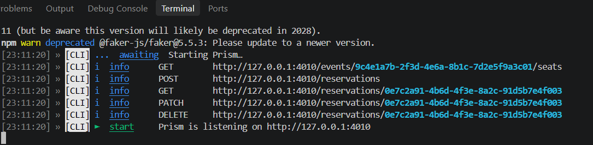
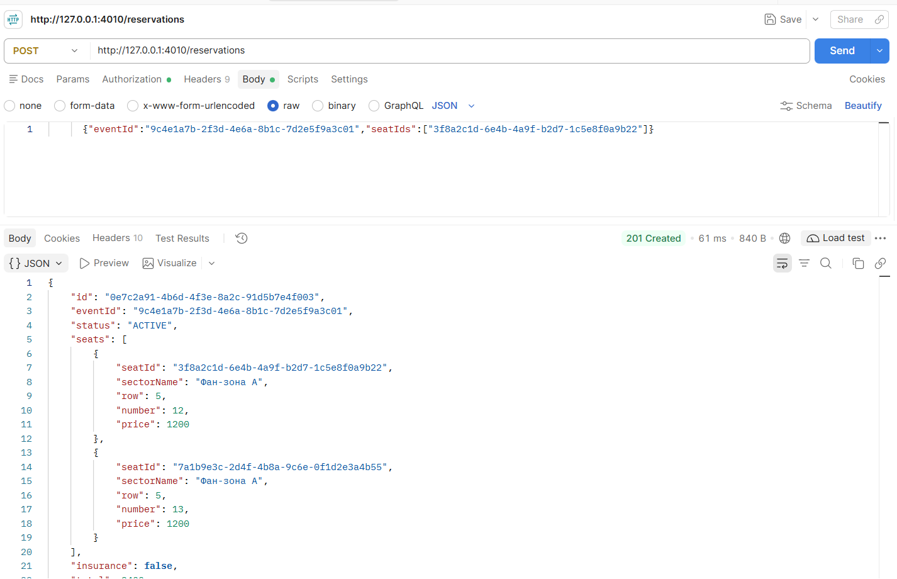
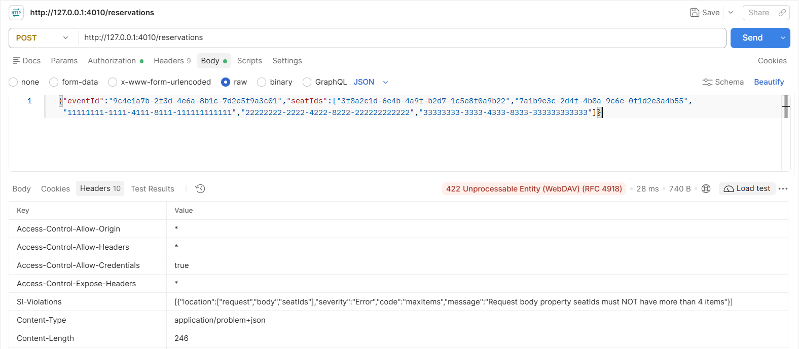
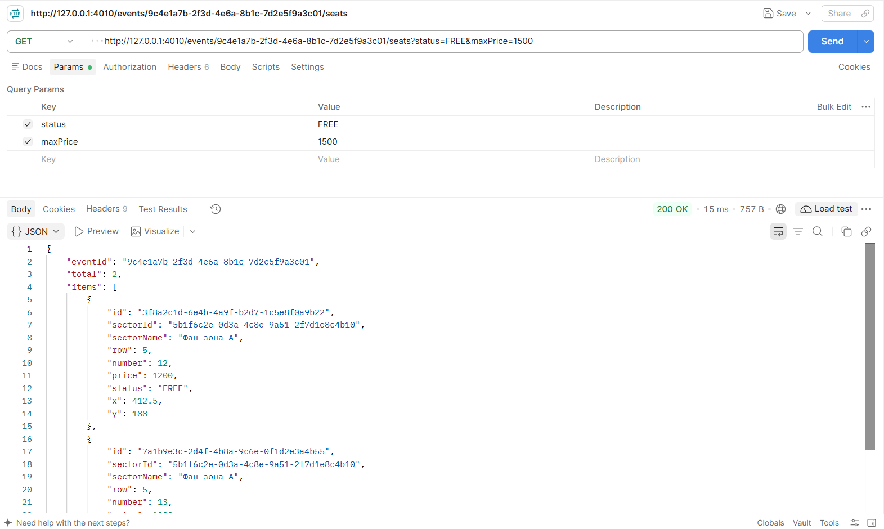
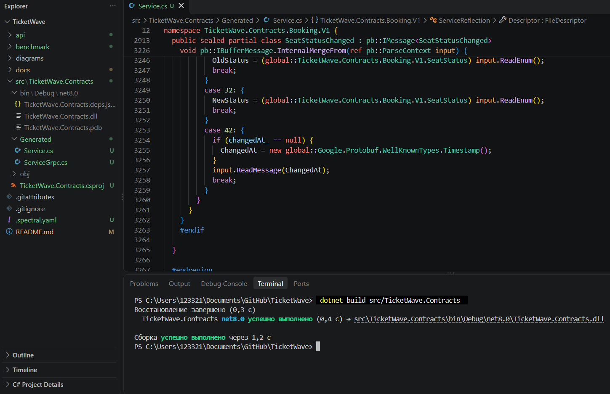

# Звіт про виконання лабораторної роботи №3

## Тема: Проєктування та специфікація API (REST OpenAPI 3.0 та gRPC Proto3)

**Студент:** Киселевич Андрій Юрійович
**Група:** 3ПР
**Варіант:** 4 - TicketWave (сервіс бронювання квитків)
**Тег у репозиторії:** `lr3`
**Посилання на репозиторій:** https://github.com/Anflloid/TicketWave

### 1. Архітектурне позиціонування інтерфейсів

Для ЛР3 я взяв модуль **Booking**, бо він найважливіший у системі (не продати одне місце двічі, NFR-05) і вже детально описаний у ЛР2 (Component і Sequence діаграми).

- **Публічний REST API** (`api/openapi.yaml`) - для Web App (Angular) і Mobile App. Через нього покупець бачить місця на схемі залу, бронює їх, додає страховку і скасовує бронювання. Він іде через API Gateway по HTTPS/JSON, як на Container-діаграмі з ЛР2.
- **Внутрішній gRPC API** (`api/service.proto`) - це контракт `IBookingModule` з Component-діаграми ЛР2. Ним користуються модуль Payment (після оплати підтвердити продаж або зняти резерв) і SignalR-хаб (отримувати зміни статусів місць). Зараз система - модульний моноліт (ADR-0001), але Booking найбільше навантажений на старті продажів, тому саме його першим винесу в окремий сервіс, якщо буде потрібно. Тоді Payment і SignalR звертатимуться до нього по gRPC, а контракт уже готовий.

Обидва контракти зроблені за підходом **Contract-First**: спочатку вручну написаний YAML і .proto, а код (стаби) генерується вже з них.

### 2. Специфікація REST API (OpenAPI 3.0)

Файл: [`api/openapi.yaml`](../api/openapi.yaml), версія OpenAPI 3.0.3.

| Метод | Шлях | Опис | Коди відповідей |
|---|---|---|---|
| GET | `/events/{eventId}/seats` | Список місць на події, фільтри `status`, `sectorId`, `maxPrice` | 200, 400, 404, 500 |
| POST | `/reservations` | Забронювати від 1 до 4 місць на 10 хвилин | 201, 400, 401, 404, 409, 422, 500 |
| GET | `/reservations/{reservationId}` | Отримати бронювання | 200, 400, 401, 404, 500 |
| PATCH | `/reservations/{reservationId}` | Додати або прибрати страховку | 200, 400, 401, 404, 422, 500 |
| DELETE | `/reservations/{reservationId}` | Скасувати бронювання | 204, 400, 401, 404, 500 |

Використані path-параметри (`eventId`, `reservationId`), query-параметри (`status`, `sectorId`, `maxPrice`) і requestBody (POST і PATCH). DTO описані в `components/schemas` з обмеженнями: `format: uuid` і `date-time`, `minimum` для ціни, ряду і номера місця, `enum` для статусів, `minItems: 1` / `maxItems: 4` / `uniqueItems` для `seatIds` (ліміт 4 квитки з NFR-11). Кожна схема має `example`, тому Prism віддає осмислені відповіді.

**RFC 7807.** Усі помилки 4xx і 5xx повертаються з типом `application/problem+json` і схемою `ProblemDetails` з обов'язковими полями `type`, `title`, `status` і необов'язковими `detail`, `instance`. Я додав два поля-розширення, які дозволяє RFC 7807:

- `errors[]` - список помилок по полях для 400/422, щоб фронтенд міг підсвітити конкретне поле;
- `conflictingSeatIds[]` - для 409, щоб на схемі залу відразу показати, які саме місця вже зайняли.

Різниця між 400 і 422 у мене така: 400 - запит неправильний за формою (не UUID, не той тип), 422 - запит правильний, але порушує бізнес-правило (наприклад, у покупця вже 3 квитки на подію, і він хоче ще 2).

**Валідація.** Контракт перевірений Spectral з власними правилами в [`.spectral.yaml`](../.spectral.yaml): крім стандартних правил `spectral:oas` є правило, що всі відповіді 4xx/5xx мають бути `application/problem+json`. Результат:

```
$ spectral lint api/openapi.yaml --ruleset .spectral.yaml
No results with a severity of 'error' found!
```

**Prism Mock Server.** Запуск:

```
$ npx @stoplight/prism-cli mock api/openapi.yaml -p 4010
[CLI] ℹ  info   GET     http://127.0.0.1:4010/events/9c4e1a7b-.../seats
[CLI] ℹ  info   POST    http://127.0.0.1:4010/reservations
[CLI] ℹ  info   GET     http://127.0.0.1:4010/reservations/0e7c2a91-...
[CLI] ℹ  info   PATCH   http://127.0.0.1:4010/reservations/0e7c2a91-...
[CLI] ℹ  info   DELETE  http://127.0.0.1:4010/reservations/0e7c2a91-...
[CLI] ▶  start  Prism is listening on http://127.0.0.1:4010
```



Тестові запити:

| № | Запит | Відповідь |
|---|---|---|
| 1 | POST `/reservations` з 2 місцями і токеном | **201 Created**, заголовок `Location`, тіло `Reservation` |
| 2 | POST `/reservations` з 5 місцями | **422**, `sl-violations`: *seatIds must NOT have more than 4 items* |
| 3 | POST `/reservations` з `eventId: "abc"` і без `seatIds` | **422**, `sl-violations`: *must have required property 'seatIds'*, *eventId must match format "uuid"* |
| 4 | POST `/reservations` без токена | **401**, `application/problem+json` |
| 5 | GET `/events/{id}/seats?status=FREE&maxPrice=1500` | **200 OK**, список місць |
| 6 | GET `/events/{id}/seats?status=SOMETHING` | **400**, `sl-violations`: *status must be equal to one of the allowed values: FREE, RESERVED, SOLD, BLOCKED* |
| 7 | GET `/reservations/{id}` з `Prefer: code=404` | **404**, `application/problem+json` |
| 8 | POST `/reservations` з `Prefer: code=409` | **409**, тіло з `conflictingSeatIds` |
| 9 | PATCH `/reservations/{id}` | **200 OK** |
| 10 | DELETE `/reservations/{id}` | **204 No Content** |

Важливий момент: Prism у тілі помилки віддає `example` з контракту, а реальну причину, чому запит не пройшов валідацію, пише в заголовок `sl-violations`. Приклад для запиту №2:

```
HTTP/1.1 422 Unprocessable Entity
Content-type: application/problem+json
sl-violations: [{"location":["request","body","seatIds"],"severity":"Error",
  "code":"maxItems","message":"Request body property seatIds must NOT have more than 4 items"}]
```

Скріншоти з Postman:







### 3. Специфікація gRPC API (Protocol Buffers v3)

Файл: [`api/service.proto`](../api/service.proto), `syntax = "proto3"`, пакет `ticketwave.booking.v1`.

Сервіс `BookingService`:

| RPC | Тип | Хто викликає | Навіщо |
|---|---|---|---|
| `ConfirmSale` | Unary | модуль Payment | Після успішної оплати перевести місця в SOLD і отримати квитки з QR |
| `ReleaseReservation` | Unary | модуль Payment, фонова задача | Зняти резерв, якщо оплату відхилено або минуло 10 хвилин |
| `GetReservation` | Unary | модуль Payment | Отримати бронювання, щоб звірити суму перед оплатою |
| `WatchSeatStatus` | Server streaming | SignalR-хаб | Потік змін статусів місць однієї події, щоб оновлювати схему залу наживо (QAS-1) |

Що використано в повідомленнях:

- **enum** `SeatStatus`, `ReservationStatus`, `ReleaseReason`, у кожного нульове значення `..._UNSPECIFIED = 0`. Це обов'язково в proto3: якщо поле не передали, воно прийде як 0, і я відрізню «не задано» від реального статусу.
- **вкладені повідомлення** `Reservation.ReservedSeat` і `ConfirmSaleResponse.IssuedTicket`.
- **типи** `string`, `int32`, `int64`, `double`, `bool`, `google.protobuf.Timestamp`. Гроші зберігаю в `int64` копійках, а не в `double`, щоб не було помилок округлення. `double` використаний для координат місця на схемі.

Перевірка компіляції:

```
$ protoc -I api --csharp_out=... --python_out=... api/service.proto
(без помилок)
```

**Генерація стабів (C#).** Для стабів створений проєкт [`src/TicketWave.Contracts`](../src/TicketWave.Contracts/TicketWave.Contracts.csproj) з пакетом `Grpc.Tools`. У `.csproj` контракт підключений як `<Protobuf Include="../../api/service.proto" GrpcServices="Both" OutputDir="Generated" />`, тому під час `dotnet build` Grpc.Tools генерує два файли:

- `Generated/Service.cs` - класи повідомлень і enum-ів;
- `Generated/ServiceGrpc.cs` - `BookingService.BookingServiceBase` (сервер) і `BookingService.BookingServiceClient` (клієнт).

Обидва файли закомічені в репозиторій.



### 4. Порівняльний аналіз (JSON vs Protobuf Benchmark)

Для порівняння взяв бронювання (`Reservation`) з 4 місцями (максимум за NFR-11), сумою, статусом, страховкою і двома часовими мітками. Скрипт: [`benchmark/payload_size.py`](../benchmark/payload_size.py), однакові дані серіалізуються в compact JSON (UTF-8, без пробілів) і в Protobuf.

| Формат | Розмір, байт |
|---|---|
| JSON (compact, UTF-8) | 880 |
| Protobuf | 483 |
| **Коефіцієнт стиснення** | **1.82x** |
| **Економія трафіку** | **45.1%** |

Швидкість (Python, 100 000 операцій):

| Операція | JSON, с | Protobuf, с |
|---|---|---|
| Серіалізація | 0.825 | 0.041 |
| Десеріалізація | 0.814 | 0.071 |

Найцікавіше, що я помітив: економія «тільки» 45%, хоча очікував більше. Причина в тому, що більшість байтів займають UUID, які в обох форматах лежать як рядки по 36 символів. Protobuf економить на іменах полів (замість `"sectorName":` один байт тегу) і на числах (varint замість тексту). Якщо зберігати UUID як `bytes` (16 байт), Protobuf вийшов би ще менше.

**Висновки щодо компромісів (Trade-offs):**

- **Швидкість (CPU).** Protobuf у тесті серіалізується приблизно в 20 разів швидше, бо не треба перетворювати числа в текст і назад та розбирати лапки. Для `WatchSeatStatus` на старті продажів (тисячі змін за секунду) це важливо.
- **Читабельність.** JSON можна відкрити в браузері, Postman чи логах і одразу зрозуміти. Protobuf - бінарний, без `.proto` файлу його не прочитати. Тому для фронтенду і мобільного застосунку я лишив REST/JSON, а gRPC тільки для внутрішніх викликів.
- **Еволюція схеми.** У Protobuf важливі номери тегів, а не імена полів. Нове поле можна додати з новим номером, і старі клієнти просто його пропустять. Видалене поле треба позначити `reserved`, щоб його номер ніхто не використав повторно. Номери існуючих полів міняти не можна.
- **Транспорт.** REST у мене через HTTP/1.1, де на одному з'єднанні запити йдуть по черзі (head-of-line blocking). gRPC працює через HTTP/2: багато запитів і стрімів в одному з'єднанні (multiplexing), бінарні кадри і стиснення заголовків HPACK. Для server streaming `WatchSeatStatus` HTTP/2 якраз і потрібен.

### 5. Висновки

У роботі я спроєктував два контракти модуля Booking за підходом Contract-First: публічний REST API на OpenAPI 3.0.3 (5 ендпоінтів, валідація DTO, помилки за RFC 7807) і внутрішній gRPC API на proto3 (3 unary і 1 server streaming RPC). REST-контракт перевірений Spectral з власним правилом для RFC 7807 і запущений у Prism, де видно, що мок сам відхиляє невалідні запити. З .proto згенеровані C#-стаби через Grpc.Tools. Порівняння показало, що Protobuf на моїх даних менший на 45% і значно швидший, але JSON зручніший для відлагодження, тому кожен формат використаний там, де він доречніший. Так я закрив ПРН17 (використання сучасних інструментів для інтеграції компонентів) і ФК03 (проєктування інтерфейсів модулів на основі вимог).
