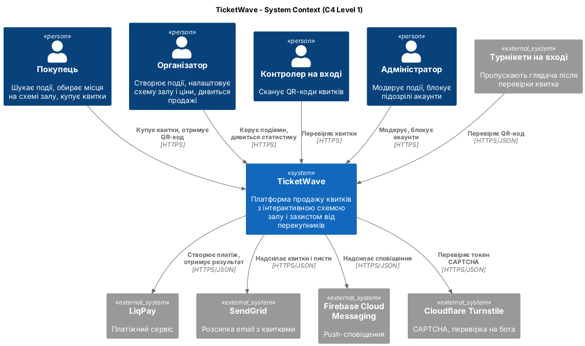
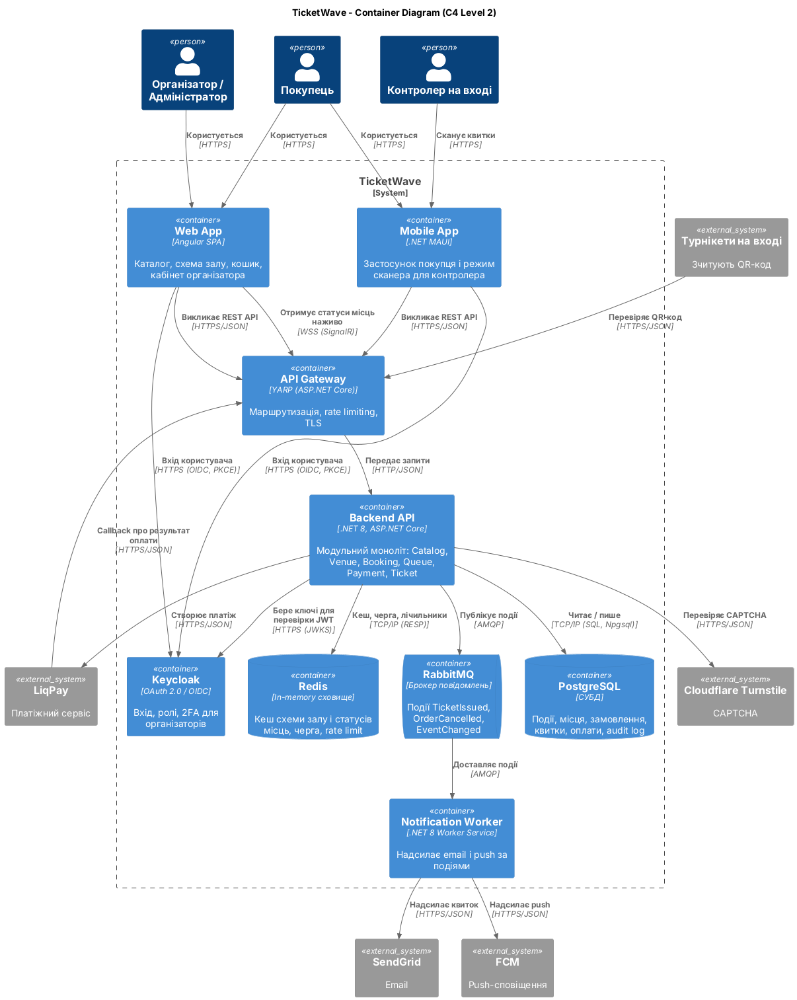
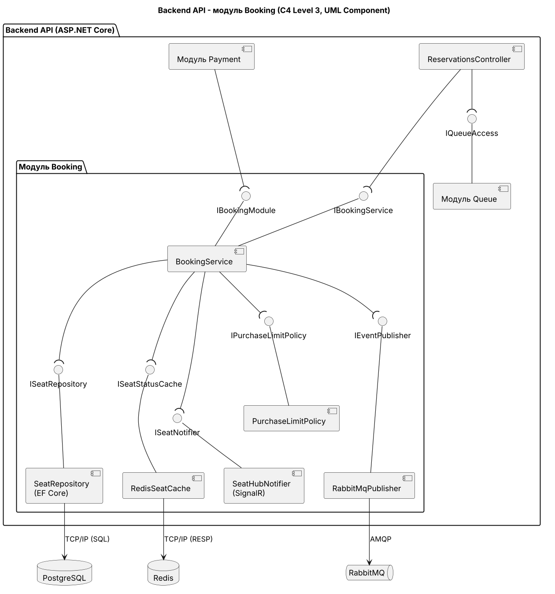
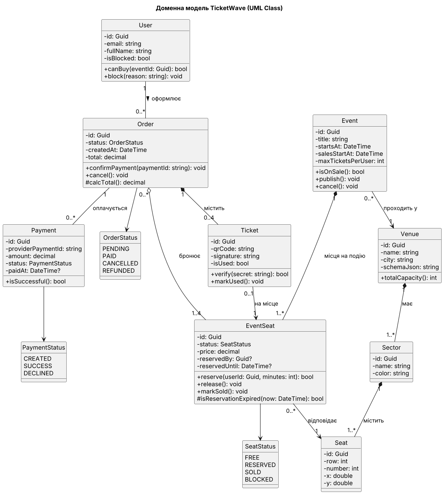
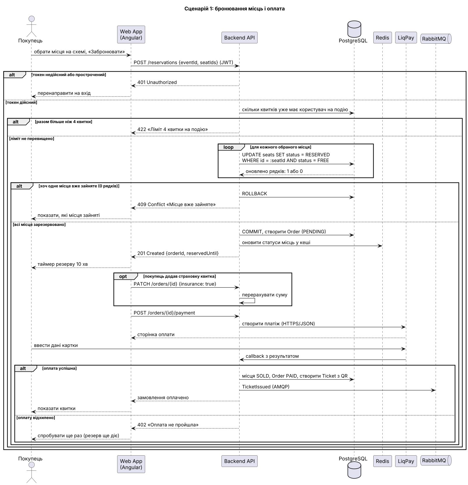
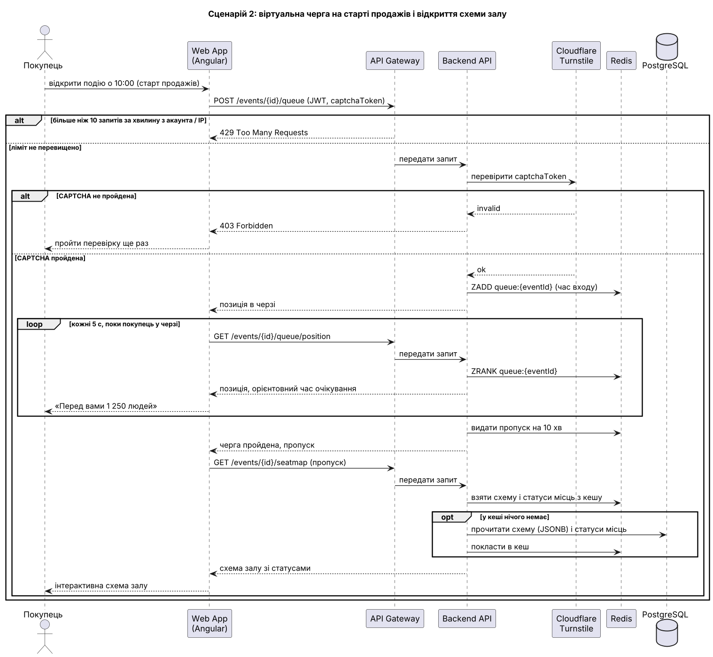
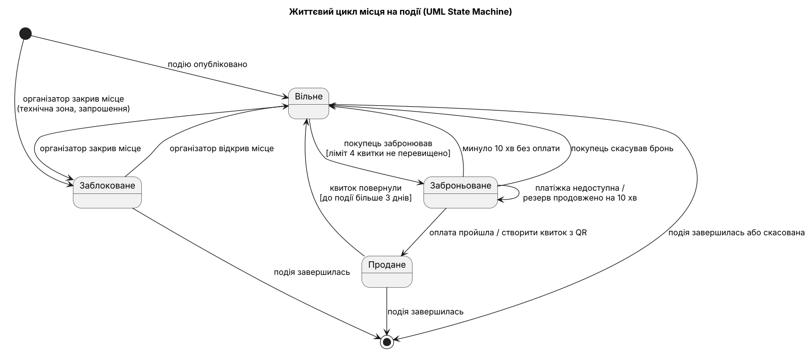

# Звіт про виконання лабораторної роботи №2

## Тема: Побудова C4 Model, UML-моделювання статичної структури та динаміки поведінки

**Лабораторна робота:** №2
**Варіант:** 4 - Online Ticket Booking & Event Platform (TicketWave)
**Студент:** Киселевич Андрій Юрійович
**Група:** 3ПР
**Репозиторій:** https://github.com/Anflloid/TicketWave, тег `lr2`

Усі діаграми зроблені в PlantUML (Diagrams as Code). Код лежить у папці [`diagrams/`](../diagrams), картинки - у [`docs/images/`](images).

Модель побудована для двох основних контекстів:

- **Контекст 1 - «Бронювання та оплата».** Покупець обирає місця, система їх резервує і приймає оплату. Учасники: покупець, LiqPay. Головна сутність: місце на події (EventSeat).
- **Контекст 2 - «Старт продажів».** Віртуальна черга, захист від ботів і відкриття схеми залу під навантаженням. Учасники: покупець, Cloudflare Turnstile. Головна сутність: та сама, бо черга потрібна саме для того, щоб чесно розподілити місця.

C4-діаграми, компонентна і класова діаграми спільні для обох контекстів. Sequence 1 описує контекст 1, Sequence 2 - контекст 2, State Machine - головну сутність обох.

## Розділ 1. C4 Model

### Level 1 - System Context

На діаграмі показано TicketWave як одну систему та її оточення. З нею працюють покупець, організатор, контролер на вході й адміністратор, а із зовнішніх систем потрібні LiqPay, SendGrid, Firebase Cloud Messaging, Cloudflare Turnstile і турнікети на вході. Оплату і CAPTCHA винесено в зовнішні сервіси, щоб не зберігати дані карток у себе (PCI DSS) і не писати власний захист від ботів.

### Level 2 - Container

На діаграмі показано, з яких частин, що запускаються окремо, складається TicketWave. Основні контейнери: Web App (Angular), Mobile App (.NET MAUI), API Gateway (YARP), Backend API (ASP.NET Core, модульний моноліт з ADR-0001), Notification Worker, Keycloak, PostgreSQL, Redis і RabbitMQ. Розсилку квитків винесено в окремий Notification Worker, який отримує події з RabbitMQ по AMQP, щоб покупець після оплати не чекав, поки відпрацює SendGrid.

Синхронні виклики підписані HTTPS/JSON (REST), HTTP/JSON (всередині мережі), TCP/IP (SQL) до PostgreSQL і TCP/IP (RESP) до Redis. Асинхронні йдуть через AMQP. Окремо є WSS (SignalR): так статус місця оновлюється в інших покупців без перезавантаження сторінки (QAS-1).

## Розділ 2. Статична структура

### UML Component Diagram (Level 3, модуль Booking)

На діаграмі показано модуль Booking всередині Backend API. BookingService надає два інтерфейси (кулька): `IBookingService` для ReservationsController і `IBookingModule` для модуля Payment. Сам він потребує п'ять інтерфейсів (розетка): `ISeatRepository`, `ISeatStatusCache`, `IPurchaseLimitPolicy`, `ISeatNotifier` і `IEventPublisher`. BookingService знає тільки ці інтерфейси і не знає класів EF Core, Redis чи RabbitMQ, тому будь-який адаптер можна замінити або підставити заглушку в тестах (NFR-14, NFR-15).

### UML Class Diagram (доменна модель)

На діаграмі показано доменну модель: 9 класів (User, Venue, Sector, Seat, Event, EventSeat, Order, Ticket, Payment) і 3 переліки статусів. Seat - це фізичне крісло в залі, а EventSeat - те саме крісло на конкретну подію зі своєю ціною і статусом. Статус винесено в EventSeat, бо одне крісло може бути вільним на одному концерті і проданим на іншому.

Ромби поставлені так:

- **Композиція** (◆): Venue ◆ Sector ◆ Seat, Event ◆ EventSeat, Order ◆ Ticket. Частина без цілого не має сенсу: видалили подію - зникли її місця, видалили замовлення - зникли його квитки.
- **Агрегація** (◇): Order ◇ EventSeat. Тут виконуються обидві умови агрегації. По-перше, місце переживає замовлення: скасували замовлення, а місце просто знову вільне. По-друге, одне місце може бути в кількох замовленнях (спочатку в скасованому, потім у новому), тому з боку Order кратність 0..*.
- **Асоціація зі стрілкою:** Ticket → EventSeat, EventSeat → Seat, Event → Venue. Сусід живе сам по собі і не є частиною.

Кратність `1..4` біля EventSeat у зв'язку з Order - це ліміт 4 квитки на замовлення (NFR-11).

## Розділ 3. Динамічна поведінка

### Sequence 1: бронювання і оплата (контекст 1)

На діаграмі показано, як покупець бронює місця і платить за них. Учасники: покупець, Web App, Backend API, PostgreSQL, Redis, LiqPay і RabbitMQ. Кожне місце резервується окремим атомарним `UPDATE ... WHERE status = FREE` всередині однієї транзакції, щоб двоє людей не купили одне місце (NFR-05, QAS-2).

Фрагменти: `alt` для 401, для ліміту 4 квитки, для зайнятого місця (409) і для результату оплати; `loop` по кожному обраному місцю; `opt` для страховки квитка.

### Sequence 2: віртуальна черга і схема залу (контекст 2)

На діаграмі показано, що відбувається на старті продажів: покупець стає в чергу, чекає і отримує схему залу. Учасники: покупець, Web App, API Gateway, Backend API, Cloudflare Turnstile, Redis і PostgreSQL. Rate limit стоїть на API Gateway, щоб боти отримували 429 ще до Backend API і не забирали в нього ресурси (QAS-4).

Фрагменти: `alt` для rate limit (429) і для CAPTCHA (403); `loop` - браузер кожні 5 секунд питає позицію в черзі; `opt` - якщо схеми залу немає в кеші, її читають з PostgreSQL.

### State Machine: життєвий цикл місця на події

На діаграмі показано стани місця на конкретній події: Вільне, Заброньоване, Продане і Заблоковане. З Заброньованого місце автоматично повертається у Вільне через 10 хвилин без оплати (NFR-06). Перехід Заброньоване → Заброньоване продовжує резерв, коли платіжний сервіс недоступний (QAS-3), щоб покупець не втратив місце не зі своєї вини. Повернення квитка (Продане → Вільне) має умову в квадратних дужках (guard): до події більше 3 днів.
