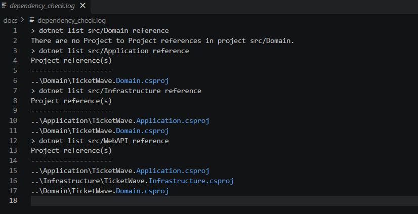
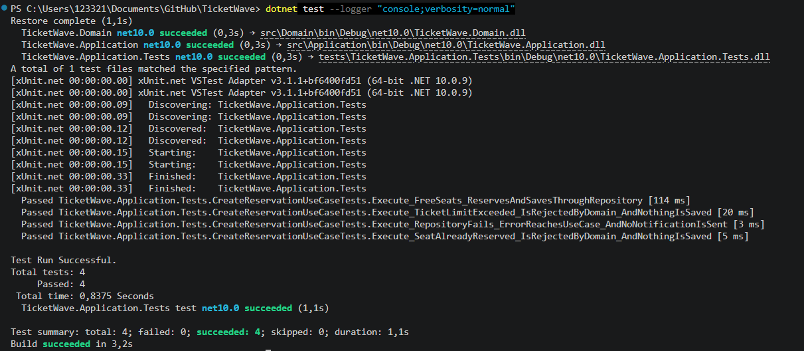

# Звіт про виконання лабораторної роботи №4

## Тема: Модульне ядро, Clean Architecture та Dependency Injection

**Студент:** Киселевич Андрій Юрійович
**Група:** 3ПР
**Варіант:** 4 - TicketWave (сервіс бронювання квитків)
**Тег у репозиторії:** `lr4`
**Посилання на репозиторій:** https://github.com/Anflloid/TicketWave

### 1. Шари і правило залежностей

Ядро зроблене для модуля Booking, того самого, що в ЛР2 (Component і Class діаграми) і в ЛР3 (`POST /reservations`). Стек - C# / .NET 10, кожен шар - окремий проєкт у `TicketWave.sln`.

| Шар | Проєкт | Що в ньому лежить |
|---|---|---|
| Domain | `src/Domain` | Сутності `EventSeat` і `Reservation`, value object `Money`, переліки `SeatStatus` і `ReservationStatus`, винятки `DomainException` і `SeatAlreadyTakenException`, порти `IEventSeatRepository` і `IReservationRepository` |
| Application | `src/Application` | Сценарій `CreateReservationUseCase`, вхідний DTO `CreateReservationCommand`, результат `CreateReservationResult`, порт `ISeatNotifier`, `NotFoundException` |
| Infrastructure | `src/Infrastructure` | Сховище в пам'яті `InMemoryTicketStore`, адаптери `InMemoryEventSeatRepository`, `InMemoryReservationRepository`, `ConsoleSeatNotifier` |
| WebAPI | `src/WebAPI` | `Program.cs`: композиційний корінь і тонкий ендпоінт `POST /reservations` |

`EventSeat` і `Reservation` - сутності, у них є `Id`, і вони змінюються протягом життя (місце стає Reserved, бронювання - Cancelled). `Money` - value object: у нього немає `Id`, два `Money(1200)` рівні, і він не змінюється, а операції `+` і `*` повертають нове значення. Тому `Money` зроблений через `record`.

Порти репозиторіїв лежать у Domain поруч із сутностями, а `ISeatNotifier` - в Application, бо оновлення схеми залу - це не правило предметної області, а дія сценарію.

**Перевірка напрямку посилань** (`dotnet list src/<шар> reference`, повний вивід у [`docs/dependency_check.log`](dependency_check.log)):

- `Domain` - посилань на інші проєкти немає, NuGet-пакетів теж немає;
- `Application` → тільки `Domain`;
- `Infrastructure` → `Application`, `Domain`;
- `WebAPI` → `Application`, `Infrastructure`, `Domain`.

Стрілки йдуть тільки всередину. Domain не знає ні про ASP.NET, ні про сховище, ні про DI-контейнер.



### 2. Сценарій використання

**`CreateReservationUseCase`** - сценарій «Забронювати місця» з контракту ЛР3 (`POST /reservations`).

Порти в конструкторі:

```csharp
public sealed class CreateReservationUseCase(
    IEventSeatRepository seats,          // читання місць
    IReservationRepository reservations, // збереження бронювань
    ISeatNotifier notifier,              // оновлення схеми залу
    TimeProvider clock)                  // поточний час
```

Усередині сценарію немає ні `new` адаптера, ні `GetService`, ні рядка з'єднання. Сценарій тільки керує кроками: знайти місця → дізнатися, скільки квитків у користувача вже є → `Reservation.Create(...)` → зберегти через порт → повідомити схему залу.

`TimeProvider` - вбудований клас .NET, а не мій порт. Я передаю його через конструктор, щоб у тестах підставити фіксований час і перевірити, що резерв діє рівно 10 хвилин.

**Доменні правила** живуть у `Reservation.Create` і `EventSeat.Reserve`, а не в сценарії і не в контролері:

- у бронюванні від 1 до 4 місць;
- усі місця з однієї події;
- разом із вже купленими не більше 4 квитків на подію (NFR-11) - інакше `DomainException`;
- місце має бути вільним - інакше `SeatAlreadyTakenException`;
- резерв діє 10 хвилин (NFR-06), страховка додає 10% до суми.

Конструктор `Reservation` - `private`, тому створити бронювання в обхід цих перевірок неможливо.

Ендпоінт у `Program.cs` тільки перекладає JSON у `CreateReservationCommand`, викликає сценарій і перекладає результат або виняток у відповідь у форматі RFC 7807, як у контракті ЛР3: `SeatAlreadyTakenException` → 409, `DomainException` → 422, `NotFoundException` → 404.

### 3. Композиційний корінь

Усі реєстрації в одному місці - `src/WebAPI/Program.cs`, контейнер Microsoft.Extensions.DependencyInjection. Біля кожної реєстрації в коді є коментар, чому саме цей цикл.

| Абстракція | Реалізація | Життєвий цикл | Чому саме цей цикл |
|---|---|---|---|
| `TimeProvider` | `TimeProvider.System` | Singleton | Без стану, однаковий для всіх запитів, створювати новий немає сенсу |
| - | `InMemoryTicketStore` | Singleton | Це і є «база» в пам'яті. Зі Scoped кожен запит бачив би порожнє сховище |
| `IEventSeatRepository` | `InMemoryEventSeatRepository` | Scoped | Один на запит. Зі справжньою БД ділив би з'єднання і транзакцію в межах запиту |
| `IReservationRepository` | `InMemoryReservationRepository` | Scoped | Те саме. Singleton не можна - тримав би з'єднання одного запиту для всіх |
| `ISeatNotifier` | `ConsoleSeatNotifier` | Transient | Без стану між викликами і дешевий, тому новий на кожне вирішення |
| - | `CreateReservationUseCase` | Scoped | Живе в межах запиту разом зі своїми Scoped-репозиторіями. Singleton - це captive dependency |

Застосунок запускається в Development (`launchSettings.json`), тому .NET сам перевіряє життєві цикли на старті. Якщо зробити сценарій Singleton, застосунок не запуститься з помилкою *Cannot consume scoped service ... from singleton*.

`InMemoryReservationRepository.SaveAsync` під `lock` ще раз перевіряє, що місця вільні, і тільки тоді записує. Це заміна атомарного `UPDATE seats ... WHERE status = 'FREE'` з ADR-0002, поки справжньої БД немає. Коли з'явиться PostgreSQL, я додам `EfReservationRepository` і поміняю один рядок реєстрації, а Domain і Application не зміняться.

### 4. Модульні тести

Проєкт `tests/TicketWave.Application.Tests` (xUnit + Moq) посилається тільки на `Application` і `Domain`. WebAPI і Infrastructure в ньому немає, тому тести не відкривають ні базу, ні сокет, ні файли. Контейнер у тестах теж не потрібен: сценарій створюється через `new` з дублерами в конструкторі.

Чим замінено порти:

- `IEventSeatRepository`, `IReservationRepository`, `ISeatNotifier` - `Mock<T>` з Moq;
- `TimeProvider` - ручний stub `FixedTimeProvider`, який завжди повертає 20.11.2026 10:00 UTC.

| Тест | Що перевіряє |
|---|---|
| `Execute_FreeSeats_ReservesAndSavesThroughRepository` | Успіх: сума 2400, резерв до 10:10, `SaveAsync` викликано рівно один раз саме з цим бронюванням, схему залу повідомлено |
| `Execute_TicketLimitExceeded_IsRejectedByDomain_AndNothingIsSaved` | Відмова домену: у користувача вже 3 квитки, хоче ще 2 → `DomainException`, `SaveAsync` не викликано жодного разу |
| `Execute_RepositoryFails_ErrorReachesUseCase_AndNoNotificationIsSent` | Збій порту: `SaveAsync` кидає `InvalidOperationException` → помилка доходить до сценарію, схему залу не повідомлено |
| `Execute_SeatAlreadyReserved_IsRejectedByDomain_AndNothingIsSaved` | Додатковий: місце вже заброньоване іншим → `SeatAlreadyTakenException`, нічого не збережено |

Лог зеленого прогону: [`docs/test_run.log`](test_run.log)


